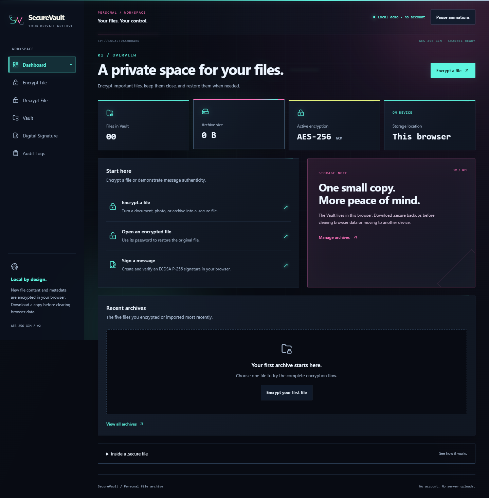

# SecureVault

[](https://github.com/PocariKaleng/Secure-Vault/actions/workflows/pages.yml)
[](LICENSE)

SecureVault is a client-side file encryption portfolio project built with React, TypeScript, Web Crypto, and IndexedDB. It opens directly to a cyberpunk dashboard and lets visitors try the complete workflow without creating an account.

**[Open the live demo](https://pocarikaleng.github.io/Secure-Vault/)**



## Why this project exists

SecureVault demonstrates a security-sensitive browser application with a documented file format, explicit trust boundaries, browser-level tests, and an automated GitHub Pages release pipeline.

- AES-256-GCM authenticated file encryption
- PBKDF2-SHA256 key derivation with 600,000 iterations
- Authenticated `.secure` v2 archives with encrypted private metadata
- Local IndexedDB Vault with import, search, decrypt, download, and delete workflows
- ECDSA P-256 / SHA-256 message signing demo
- Responsive cyberpunk interface with reduced-motion support
- Content Security Policy, dependency audit, and production artifact smoke tests

File contents, passwords, and signing private keys never leave the browser. The application has no backend, analytics, account system, or built-in secrets.

## Run locally

Requires Node.js 22.12 or later and npm.

```bash
cd frontend
npm ci
npm run dev
```

Open the localhost URL printed by Vite. Web Crypto requires a secure context; localhost and HTTPS satisfy that requirement.

Run every local quality gate with:

```bash
cd frontend
npm run lint
npm run typecheck
npm test
npm run build
npm audit --audit-level=high
```

## Deploy to GitHub Pages

1. Push a change to the repository's `main` branch.
2. Open **Settings → Pages** and set **Source** to **GitHub Actions** when configuring a fork for the first time.
3. The `Quality and deploy` workflow validates the app, builds it with the repository base path, tests the production artifact, and publishes it.

The app uses hash routes, so dashboard URLs remain reload-safe on static hosting. The deployment URL appears in the repository's **Deployments** section after the workflow succeeds.

## Security boundaries

New `.secure` v2 downloads encrypt the original content, filename, MIME type, size, and creation timestamp. The local Vault keeps a separate plaintext index copy of filenames, sizes, timestamps, algorithms, and archive metadata so the interface can search and sort records. The activity log is also plaintext local browser data. Anyone who can access or modify that browser profile can inspect or alter this local index and log.

SecureVault is a portfolio demonstration and has not received an independent cryptographic audit. Read [SECURITY.md](SECURITY.md) before using it with sensitive data.

## Project documentation

- [Technical documentation](frontend/README.md)
- [Security policy and threat model](SECURITY.md)
- [Contribution guide](CONTRIBUTING.md)
- [Roadmap](ROADMAP.md)
- [Changelog](CHANGELOG.md)

Released under the [MIT License](LICENSE).
